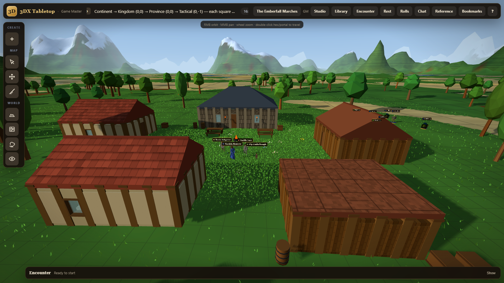
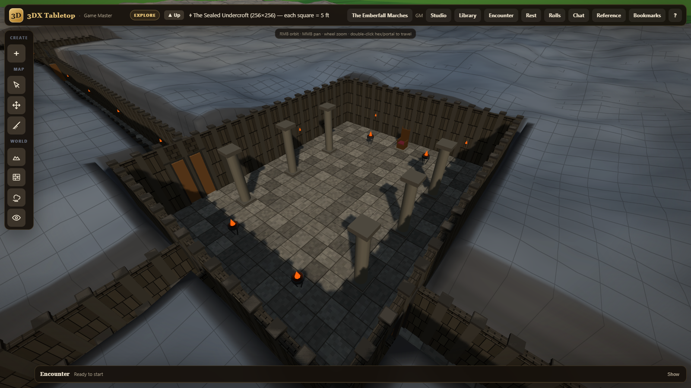
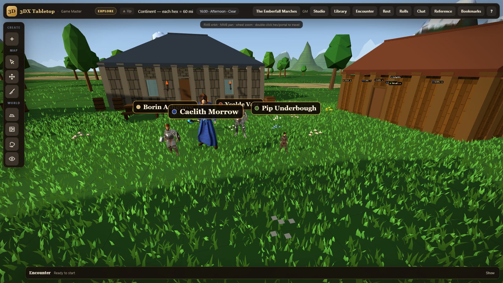
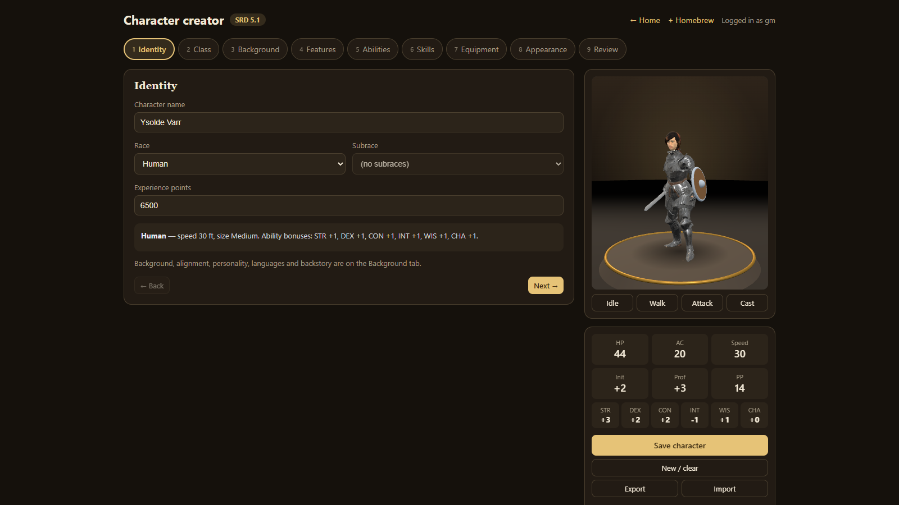
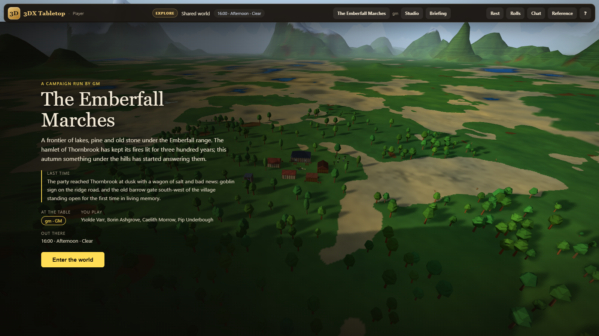

# 3DX

**A D&D 5e virtual tabletop in a 3D world that doesn't end.**

The GM zooms from a 60-mile continent hex down to a 5-foot square on the same
ground. Players walk their characters through it, and the server referees the
fight: it rolls every die, enforces turns and movement, and resolves areas and
saving throws. Everything runs in the browser with no build step, on a
Node server with two dependencies.



## Try it

```bash
npm install
npm run demo
```

Then open http://localhost:3000. The demo builds a ready-made table, *The
Emberfall Marches*: a village, a level-5 party, a goblin war band, and a
dungeon behind a portal. There are no passwords. Sign in as **`gm`** to run
the game, or as **`player`** to play the party. Open the GM screen in one tab
and the player screen in another to watch them sync.

The demo's state lives in `data/demo/`. Delete that folder to start fresh.

For a real table, run `npm start`. On first visit from the host computer you
create the host account, and the host then adds the other players.

## What's in it

**The world**
- One infinite procedural world, streamed in chunks with LOD rings and a
  floating origin. Elevation, moisture and temperature drive biomes, snowlines,
  frozen seas and an animated ocean.
- The DMG map tiers (Continent 60 mi, Kingdom 6 mi, Province 1 mi, Tactical
  5 ft) are zoom levels over the same ground, not separate maps.
- Each campaign has its own seed, world presets, biome palette and spawn
  point, chosen in a 5-step wizard with a live preview map.
- A day/night clock, seeded weather (rain, snow, fog, storms, rainbows), fog
  of war, and server-filtered token vision with darkvision, blindsight,
  tremorsense and light sources.

**The GM's tools**
- Heightmap and biome brushes. Painting a hex reshapes the generator, not
  just its colour.
- Lakes, rivers, and tile-brush buildings: walls with doors and windows,
  multi-storey floors, stairs, and gable or hip roofs.
- Furniture and light sources.
- Portal-linked pocket maps for dungeons carved into real heightmaps.



**The rules**
- Server-authoritative 5e combat: initiative, the full action economy
  (action, bonus action, Extra Attack, riders, resource pools), conditions, and movement
  priced by the terrain (slopes, snow, wading, climbing, flight).
- Areas are aimed on the map: cones, lines, spheres and cubes.
- Saves belong to whoever plays the creature.
- Concentration checks, lingering zones, summoned spell objects, spell slots
  and short and long rests that carry between fights.
- 334 SRD monsters, each with a 3D model.
- Homebrew builder for monsters, races, classes, subclasses, backgrounds,
  feats, spells and items. Features carry real mechanics (bonuses, combat
  actions, riders, resource pools, pick-N choices), and any SRD entry can be
  cloned as a template.

**The table**
- Character creator with a parametric 3D body (MakeHuman-style morphs and
  fitted clothing) and Aurora Builder import. The sculpted armour sets and
  non-human race bodies in the screenshots are private add-ons that this
  repository does not include. Without them, characters wear their clothes
  and dragonborn or tabaxi use the base body.
- Shared roll log, dice macros, chat with private whispers, a journal, a
  treasury, XP awards and session recaps.
- Players get an in-game SRD reference and a campaign hall to start from.
- Touch input on both tabletop screens.



| Character creator | Campaign hall (player screen) |
|---|---|
|  |  |

## How it's built

- **Server:** `server.js` is Express and Socket.IO with JSON-file persistence
  (atomic writes plus a `.bak` copy). It holds the combat rules engine, and it
  filters what each player may see (fog, vision, other players' sheets).
- **Clients:** vanilla ES modules. three.js r132 is vendored and loaded through
  an inline import map, so there is no bundler and no transpiler.
- **Shared modules:** the pure ones (world generator, ground and movement
  cost, walls, vision, areas, weather) run unchanged in the browser and on the
  server, so both sides agree on every height, wall and line of sight.
- **Tests:** `npm test` runs the `node:test` suite. It covers the socket
  protocol, persistence, combat and the rules interpreter, and it pins
  golden-value checks on the world generator.

Routes: `/` is the lobby, `/gm` the GM screen, `/player` the player screen,
`/creator` the character creator, and `/homebrew` the homebrew builder. `/gm`
and `/player` take `?campaign=<id>`.

## Data and accounts

Runtime state is saved as JSON under `data/saves/`, or under
`THREEDX_DATA_DIR` when that variable is set. Both are gitignored.

Passwords are scrypt-hashed and can only be set by the host. Sessions are
signed tokens that end on a password reset. Traffic is plain HTTP, so put a
TLS proxy in front before exposing a table to the internet.

## License

The code is [MIT](LICENSE). Bundled content keeps its own license:

- **Rules text:** System Reference Document 5.1 by Wizards of the Coast,
  CC-BY-4.0 ([attribution](data/srd/ATTRIBUTION.md)).
- **Monster models:** Quaternius, CC0
  ([attribution](public/assets/monsters/ATTRIBUTION.md)).
- **Character kit:** MakeHuman assets and the Quaternius Universal Animation
  Library, CC0 ([attribution](public/assets/characters/ATTRIBUTION.md)).
- **three.js:** MIT.

3DX is unofficial fan content and is not affiliated with Wizards of the Coast.
